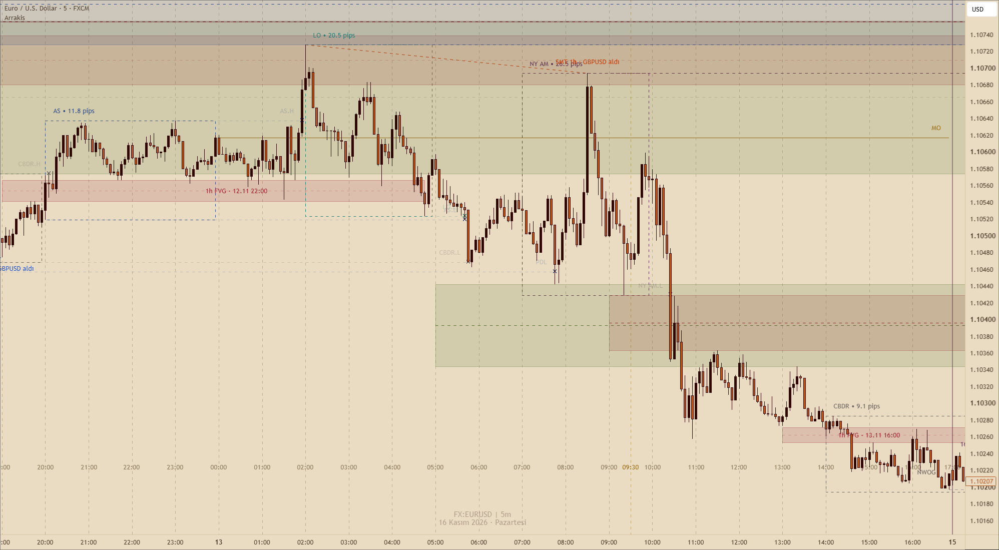
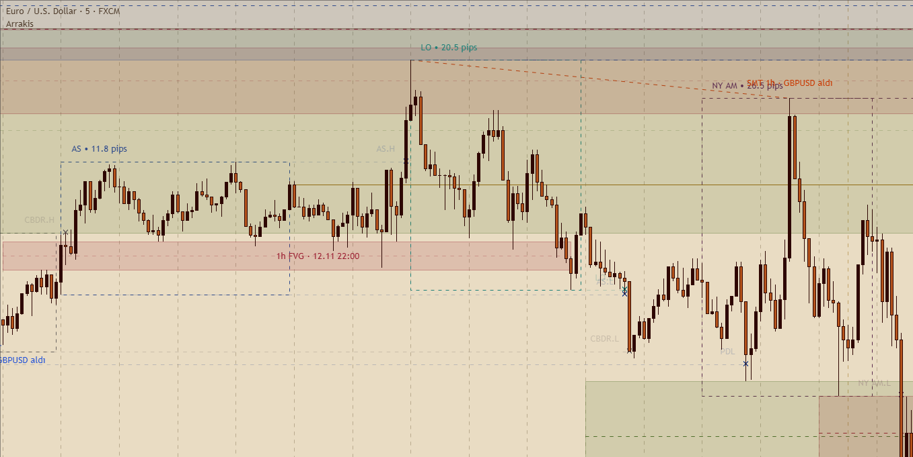
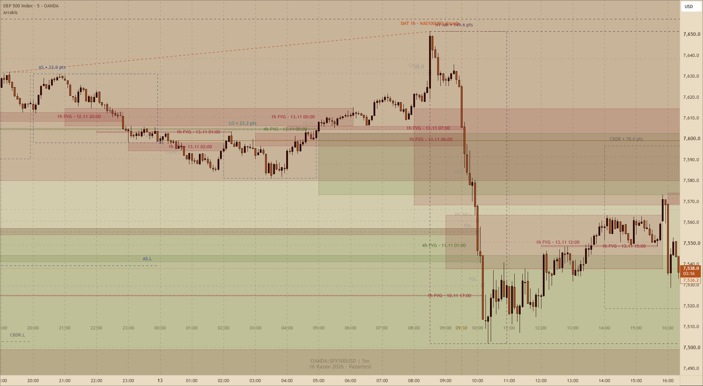
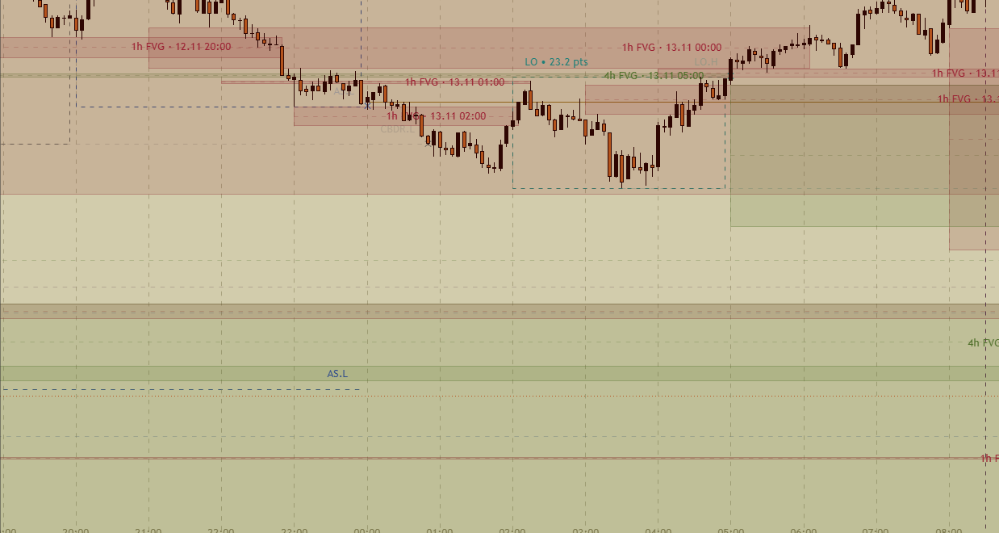
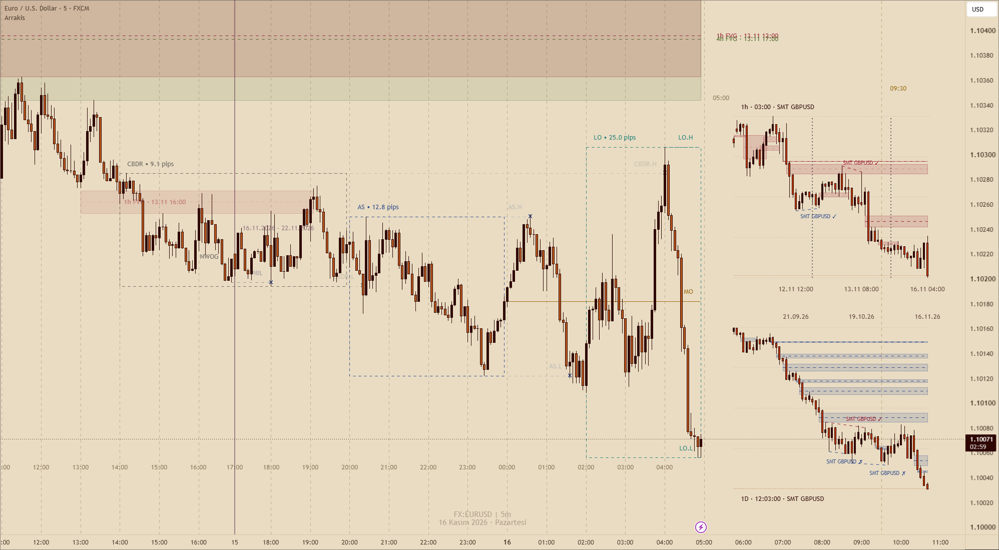
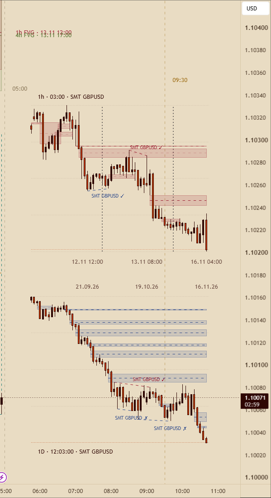
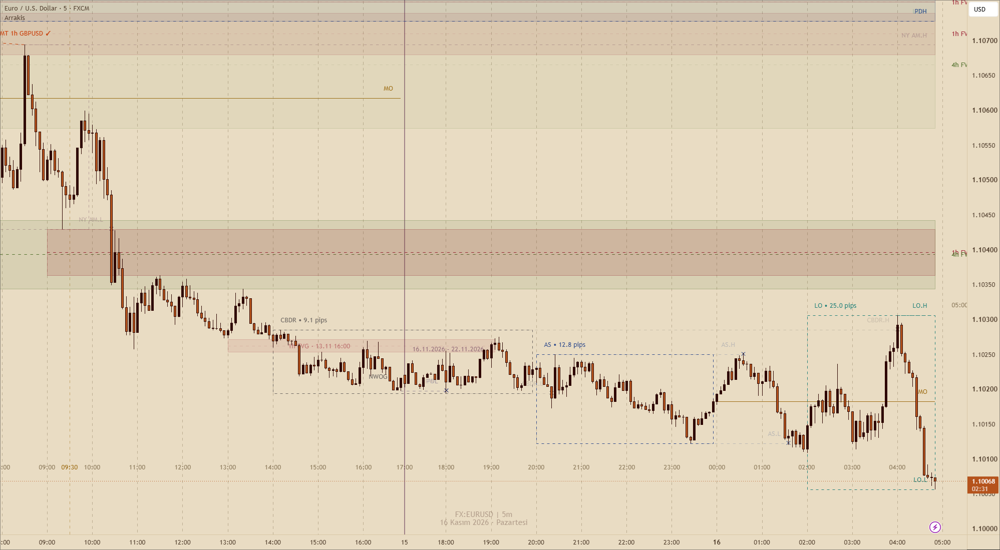
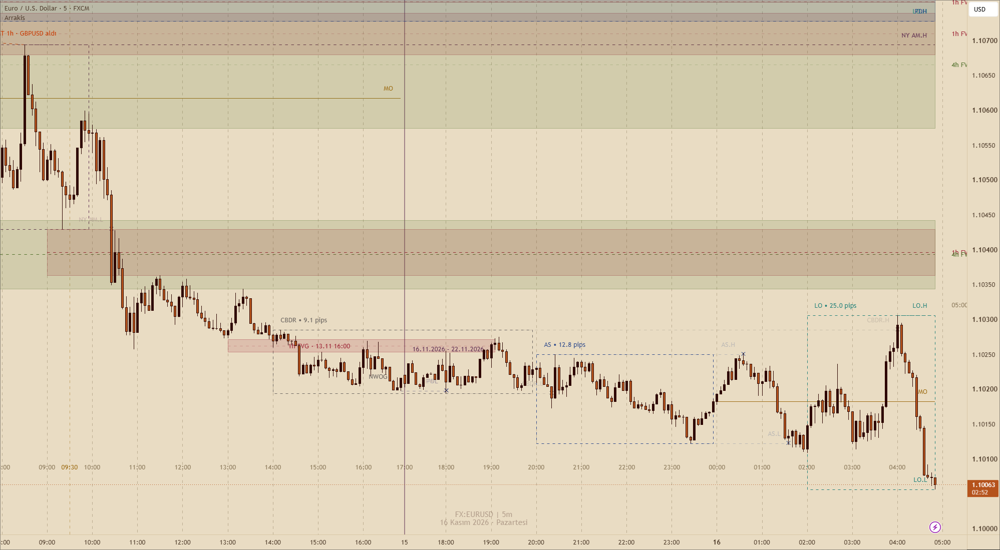

# Arrakis Toolkit

**[Türkçe](#türkçe) · [English](#english)**

TradingView için ICT tarzı bir zaman ve seviye aracı. Pine Script v6 ile yazıldı.
An ICT-style time and level toolkit for TradingView, written in Pine Script v6.

> **cTrader** kullanıyorsan: [arrakis-toolkit-ctrader](https://github.com/omeryagci/arrakis-toolkit-ctrader)
>
> Using **cTrader**? See [arrakis-toolkit-ctrader](https://github.com/omeryagci/arrakis-toolkit-ctrader)

---

## Türkçe

Arrakis Toolkit, gün içi işlemlerde baktığım her şeyi tek bir indikatörde toplar:

- killzone kutuları
- önceki gün, hafta ve ay seviyeleri
- açılış boşlukları
- Midnight Open
- birden çok zaman diliminin FVG'leri
- SMT uyumsuzlukları
- üst zaman dilimi mini grafikleri

Bütün saatler New York saatine göredir.

### İçindekiler

- [Kurulum](#kurulum)
- [Killzone kutuları](#killzone-kutuları)
- [FVG'ler](#fvgler)
- [SMT](#smt)
- [Mini grafikler (HTF mumları)](#mini-grafikler-htf-mumları)
- [Seviyeler: PDH/PDL, NWOG/NDOG, Midnight Open](#seviyeler-pdhpdl-nwogndog-midnight-open)
- [Ayırıcılar](#ayırıcılar)
- [Watermark](#watermark)
- [Görünüm: Temiz / Tam](#görünüm-temiz--tam)
- [Notlar ve sınırlar](#notlar-ve-sınırlar)

### Kurulum

1. TradingView'da bir grafik aç ve alttan **Pine Editor**'ü aç.
2. [`arrakis-toolkit.pine`](arrakis-toolkit.pine) dosyasının tamamını kopyala ve editöre yapıştır.
3. **Kaydet**'e, ardından **Grafiğe ekle**'ye bas.
4. İndikatörün ayarlarını grafikteki "Arrakis" yazısına çift tıklayarak açabilirsin.

Renkler, krem arka planlı bir "Dune" grafik temasına göre seçildi: arka plan `#E9DCC3`, yükselen mum `#2E0602`, düşen mum `#C93800`. Koyu temada da çalışır, ama renkleri ayarlardan değiştirmen gerekebilir.

### Killzone kutuları

| Kutu | Saat (NY) | Not |
|---|---|---|
| **AS** (Asya) | 20:00 – 00:00 | |
| **LO** (Londra) | 02:00 – 05:00 | |
| **NY AM** | Forex: 07:00 – 10:00 · Endeks: 08:30 – 11:00 | Sembole göre otomatik |
| **CBDR** | 14:00 – 20:00 | Central Bank Dealers Range |

- **Başlık:** Her kutunun başlığında seansın genişliği yazar. Forex'te pip, diğer sembollerde puan kullanılır, örneğin `LO • 20.5 pips` ya da `LO • 23.2 pts`.
- **Seviyeler:** Kutunun high ve low seviyeleri, fitil değene kadar en fazla 2 işlem günü sağa uzar. Alınan seviye soluklaşır ve değdiği yere ✕ konur.
- **NY AM saati:** Sembole göre kendiliğinden seçilir. EURUSD, GBPUSD gibi forex paritelerinde, kur vadelilerinde (6E, 6B…) ve DXY'de 07:00–10:00 kullanılır. US500, NAS100, ES gibi endekslerde ve diğer her şeyde 08:30–11:00 kullanılır. İstersen ayarlardan elle seçebilirsin.
- **Ayarlar:** Her kutunun adı, saati, rengi, çizgi stili ve dolgusu ayarlardan değişir.

Endeks grafiğinde NY AM kutusu 08:30'da başlar:

### FVG'ler

Fair Value Gap'ler birden çok zaman diliminden aynı anda çizilir: 1m, 5m, 15m, 30m, 1h, 4h, 8h, 1D, 1W ve 1M. Varsayılan olarak 1h, 4h, 1D ve 1W açıktır. Sayı sınırı yoktur.

- **Etiket:** Zaman dilimini ve FVG'nin **kesinleştiği anı** yazar, yani üçüncü mumun kapandığı zamanı. Örneğin `1h FVG · 13.11 02:00`. Günlük ve üstü zaman dilimlerinde sadece tarih yazar.
- **Orta çizgi (CE):** Kesikli çizilir. Fiyat CE'ye değince soluklaşır.
- **Dolan FVG:** Silinmez, soluk kalır.
- **Fiyata yakınlık:** Fiyatın hemen üstündeki ve altındaki FVG tam renkte kalır, diğerleri biraz soluklaşır.
- **Uzama süresi:** Her zaman dilimi için ayrı ayarlanabilir.

### SMT

İki ilişkili sembolün art arda iki swing'ine bakar: biri önceki seviyeyi alıp diğeri almadıysa bu bir SMT uyumsuzluğudur. High'larda bearish (kırmızı), low'larda bullish (mavi) çizilir. Etikette karşı sembol ve onun seviyeyi alıp almadığı (✓ / ✗) yazar.

- **Ana grafikte SMT:** Bir üst zaman diliminden hesaplanır ve çizginin uçları gerçek fitillere oturur.

  | Grafik | SMT zaman dilimi |
  |---|---|
  | 1m | 15m |
  | 5m | 1h |
  | 15m | 4h |
  | 1h, 4h | 1D |

- **Mini grafiklerde SMT:** Her mini grafik kendi zaman diliminde ayrıca SMT gösterir.
- **Otomatik karşı sembol:** EURUSD ↔ GBPUSD, AUDUSD ↔ NZDUSD, USDJPY ↔ USDCHF, XAUUSD ↔ XAGUSD, NAS100 ↔ SPX500, US100 ↔ US500, NQ ↔ ES, MNQ ↔ MES, GC ↔ SI, BTC ↔ ETH. DXY, EURUSD ile **ters** ilişkili olarak karşılaştırılır. Listede olmayan sembollerde karşı sembolü ayarlardan elle seçebilirsin.

### Mini grafikler (HTF mumları)

Grafiğin sağında iki küçük üst zaman dilimi grafiği durur. Ana grafiği değiştirmeden büyük resmi görmeyi sağlar.

- **Zaman dilimleri:** Grafiğin zaman dilimine göre kendiliğinden seçilir, istersen elle de seçebilirsin.

  | Grafik | Üst grup | Alt grup |
  |---|---|---|
  | 1m | 15m | 1h |
  | 5m | 1h | 1D |
  | 15m | 4h | 1D |
  | 1h – 4h | 1D | 1W |
  | daha üstü | 1M | 3M |

- **İçerik:** Varsayılan olarak son 60 mum çizilir. Ana grafikle aynı mum renklerini kullanır. Üzerinde FVG'ler, günlük ayırıcı, ızgara, zaman ekseni, son fiyat çizgisi ve SMT bulunur.
- **Başlık:** Zaman dilimini, mumun kapanmasına kalan süreyi ve SMT karşı sembolünü yazar, örneğin `1h · 03:00 · SMT GBPUSD`.
- **Boyut:** Dikey boy, mum kalınlığı, grafikten uzaklık ve mum aralığı ayarlanabilir.

### Seviyeler: PDH/PDL, NWOG/NDOG, Midnight Open

- **PDH/PDL, PWH/PWL, PMH/PML:** Önceki gün, hafta ve ayın high ve low seviyeleri. Seviye alınınca işaretlenir. Kaç gün, hafta ya da ay geriye gidileceği ayarlanabilir.
- **NWOG / NDOG:** Yeni haftanın ve yeni günün açılış boşlukları. Orta çizgisi (CE) de çizilir. Boşluk dolunca kutu orada durur, yarısı dolunca CE soluklaşır.
- **Midnight Open (MO):** NY 00:00 açılış fiyatı. 17:00'ye kadar uzar ve dokunulunca durmaz. Varsayılan olarak son 5 gün çizilir.

### Ayırıcılar

- **Saatlik:** Etiketleri grafiğin en altına sabitlenir, grafiği kaydırınca da görünür kalır.
- **09:30:** Makro ayırıcısı.
- **Günlük ve haftalık:** Sembolün kendi mumlarını takip eder. Forex'te gün 17:00'de başlar.
- **Sıradaki ayırıcı:** Henüz gelmemiş ayırıcı sağ tarafta önceden gösterilir.
- **3 ekstra ayırıcı:** Belirli bir saat ve günler, aylık, üç aylık ya da yıllık olarak ayarlanabilir.
- **Gizleme:** Her ayırıcı belli bir zaman diliminin üstünde gizlenir. Örneğin saatlik ayırıcı 15m'den büyük grafiklerde çizilmez.

### Watermark

Grafiğin altında sembol, borsa ve zaman dilimi yazar. Altındaki satırda **grafiğin tarihi** yazar, örneğin `16 Kasım 2026 · Pazartesi`. Bu tarih bugünün tarihi değil, son mumun tarihidir. Tekrar oynat (Replay) ile geri sardığında, o anda bulunduğun günü gösterir. İstersen grafiğin üstüne ikinci bir watermark da ekleyebilirsin.

### Görünüm: Temiz / Tam

Genel ayarlardaki **Görünüm** seçeneği grafiğin ne kadar yoğun görüneceğini belirler. İki modda da hiçbir şey kaybolmaz.

- **Temiz** (varsayılan): Geçmiş günlerin kutuları, uzak üst zaman dilimi FVG'leri ve eski SMT'ler soluklaşır. Bugün ve fiyata yakın olanlar öne çıkar.
- **Tam:** Her şey aynı güçte çizilir.

| Temiz | Tam |
|---|---|
|  |  |

### Notlar ve sınırlar

- **Çizim sınırı:** TradingView bir indikatörde en fazla 500 kutu, 500 çizgi ve 500 etiket çizer. Çok uzun geçmişte en eski çizimler silinir.
- **Zaman dilimi sınırı:** Killzone kutuları varsayılan olarak 1h ve altındaki grafiklerde çizilir. Bu sınırı ayarlardan değiştirebilirsin.
- **Yatırım tavsiyesi değildir:** Bu araç kişisel kullanım için yazıldı.

---

## English

Arrakis Toolkit brings everything I look at for intraday trading into one indicator:

- killzone boxes
- previous day, week and month levels
- opening gaps
- Midnight Open
- multi-timeframe FVGs
- SMT divergences
- higher-timeframe mini charts

All times are New York time.

### Contents

- [Installation](#installation)
- [Killzone boxes](#killzone-boxes)
- [FVGs](#fvgs)
- [SMT divergence](#smt-divergence)
- [Mini charts (HTF candles)](#mini-charts-htf-candles)
- [Levels: PDH/PDL, NWOG/NDOG, Midnight Open](#levels-pdhpdl-nwogndog-midnight-open)
- [Separators](#separators)
- [Watermark](#watermark-1)
- [View: Clean / Full](#view-clean--full)
- [Notes and limits](#notes-and-limits)

> The settings menu is in Turkish. Each section below gives the Turkish name of the setting it talks about.

### Installation

1. Open a chart on TradingView, then open the **Pine Editor** at the bottom.
2. Copy the whole [`arrakis-toolkit.pine`](arrakis-toolkit.pine) file and paste it into the editor.
3. Click **Save**, then **Add to chart**.
4. Double-click "Arrakis" on the chart to open its settings.

The colors are tuned for a cream "Dune" chart theme: background `#E9DCC3`, up candles `#2E0602`, down candles `#C93800`. It also works on a dark theme, though you may need to change the colors in the settings.

### Killzone boxes

| Box | Time (NY) | Note |
|---|---|---|
| **AS** (Asia) | 20:00 – 00:00 | |
| **LO** (London) | 02:00 – 05:00 | |
| **NY AM** | Forex: 07:00 – 10:00 · Indices: 08:30 – 11:00 | Picked automatically per symbol |
| **CBDR** | 14:00 – 20:00 | Central Bank Dealers Range |

- **Title:** Each box title shows the session range, in pips on forex and points elsewhere, for example `LO • 20.5 pips` or `LO • 23.2 pts`.
- **Levels:** The box high and low extend to the right until a wick touches them, for up to 2 trading days. A taken level fades and gets a ✕ where it was hit.
- **NY AM hours:** Chosen per symbol. Forex pairs such as EURUSD and GBPUSD, FX futures (6E, 6B…) and DXY use 07:00–10:00. Indices such as US500, NAS100 and ES, and everything else, use 08:30–11:00. You can override this in the settings (`Piyasa`).
- **Settings:** Each box's name, hours, color, line style and fill can be changed.

On an index chart, the NY AM box starts at 08:30:

### FVGs

Fair Value Gaps are drawn from several timeframes at once: 1m, 5m, 15m, 30m, 1h, 4h, 8h, 1D, 1W and 1M. 1h, 4h, 1D and 1W are on by default. There is no count limit.

- **Label:** Shows the timeframe and the moment the FVG was **confirmed**, which is when its third candle closed, for example `1h FVG · 13.11 02:00`. Daily and higher timeframes show the date only. Setting: `Kesinleşme zamanını yaz`.
- **Midline (CE):** Drawn dashed. It fades once price touches it.
- **Filled FVGs:** Not deleted. They stay faded.
- **Distance from price:** The FVG just above and the one just below price keep full color. The others fade a little.
- **Extension:** Can be set separately for each timeframe.

### SMT divergence

The indicator compares two consecutive swings of two correlated symbols. If one symbol takes the previous level and the other does not, that is an SMT divergence. It is drawn as bearish (red) on highs and bullish (blue) on lows. The label names the other symbol and whether it took the level (✓ / ✗).

- **Main chart:** SMT is computed on a higher timeframe, and the line ends sit on the real wicks.

  | Chart | SMT timeframe |
  |---|---|
  | 1m | 15m |
  | 5m | 1h |
  | 15m | 4h |
  | 1h, 4h | 1D |

- **Mini charts:** Each mini chart also shows SMT on its own timeframe.
- **Automatic pairing:** EURUSD ↔ GBPUSD, AUDUSD ↔ NZDUSD, USDJPY ↔ USDCHF, XAUUSD ↔ XAGUSD, NAS100 ↔ SPX500, US100 ↔ US500, NQ ↔ ES, MNQ ↔ MES, GC ↔ SI, BTC ↔ ETH. DXY is compared with EURUSD as an **inverse** pair. For any other symbol, pick the pair by hand in the settings (`Karşı sembol` → `Elle`).

### Mini charts (HTF candles)

Two small higher-timeframe charts sit to the right of price, so you can see the bigger picture without switching the chart.

- **Timeframes:** Picked from the chart timeframe automatically, or set by hand.

  | Chart | Upper group | Lower group |
  |---|---|---|
  | 1m | 15m | 1h |
  | 5m | 1h | 1D |
  | 15m | 4h | 1D |
  | 1h – 4h | 1D | 1W |
  | higher | 1M | 3M |

- **Contents:** The last 60 candles by default, in the same candle colors as the main chart. They show FVGs, a daily separator, a grid, a time axis, a last-price line and SMT.
- **Title:** Shows the timeframe, the time left until the candle closes, and the SMT pair, for example `1h · 03:00 · SMT GBPUSD`.
- **Size:** Height, candle width, distance from price and candle spacing are adjustable.

### Levels: PDH/PDL, NWOG/NDOG, Midnight Open

- **PDH/PDL, PWH/PWL, PMH/PML:** Previous day, week and month highs and lows. A level is marked when it gets taken. You can set how many days, weeks or months back to draw.
- **NWOG / NDOG:** New week and new day opening gaps, with their midline (CE). A gap stops extending once it is filled, and its CE fades when half of it is filled.
- **Midnight Open (MO):** The 00:00 NY opening price. It extends until 17:00 and does not stop on touch. The last 5 days are drawn by default.

### Separators

- **Hourly:** Labels are pinned to the bottom of the chart, so they stay visible while you scroll.
- **09:30:** Macro separator.
- **Daily and weekly:** Follow the symbol's own candles. On forex, the day starts at 17:00.
- **Next separator:** The upcoming separator is shown ahead of time on the right.
- **3 extra separators:** Can be set to a time on chosen weekdays, or to monthly, quarterly or yearly.
- **Hiding:** Each separator hides above a chosen timeframe. For example, the hourly separator is not drawn on charts above 15m.

### Watermark

The bottom watermark shows the symbol, exchange and timeframe. The line below it shows the **chart's date**, for example `16 Kasım 2026 · Pazartesi`. This is the date of the last candle, not today's date, so in Bar Replay it shows the day you rewound to. You can also add a second watermark at the top of the chart.

### View: Clean / Full

The **Görünüm** setting in the general settings (`Genel`) sets how busy the chart looks. Nothing disappears in either mode.

- **Temiz** (Clean, default): Past days' boxes, distant higher-timeframe FVGs and older SMTs fade, so today's levels and the ones near price stand out.
- **Tam** (Full): Everything is drawn at full strength.

| Clean | Full |
|---|---|
|  |  |

### Notes and limits

- **Drawing limit:** TradingView allows at most 500 boxes, 500 lines and 500 labels per indicator. On long histories the oldest drawings are removed.
- **Timeframe limit:** Killzone boxes are drawn on 1h and lower charts by default. You can change this limit in the settings.
- **Not financial advice:** This tool was written for personal use.

---

## License

[MIT](LICENSE)
